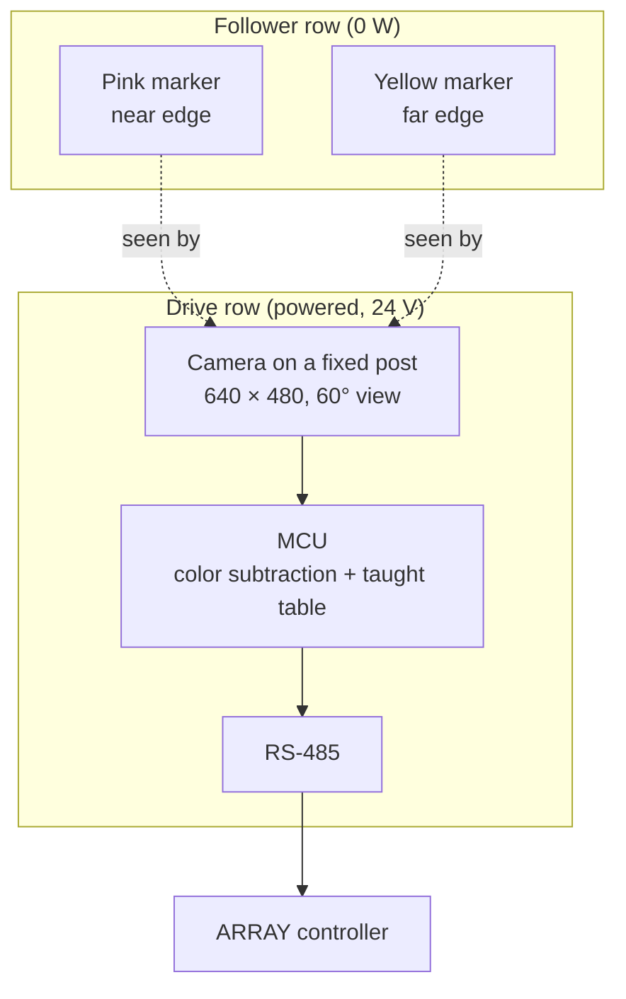

# Camera Concept

!!! info "Alternative concept under study"
    This is an alternative to [Concept 5](../solution.md) that the team is evaluating. It is not the selected design.
    Idea and simulation by Lakshanand Sugumar.

A small camera on the **drive row** watches two colored markers on the **follower row**. As the follower row tilts, the markers move in the image. After a one-time teaching sweep against a reference inclinometer, the camera reads the follower's tilt angle directly. The follower row still needs no power.

## How it works

1. **See.** A camera on a fixed post at the drive row looks across the 6–8 m gap at the follower row.
2. **Isolate the markers with color subtraction.** For every pixel, *yellow score = min(R, G) − B* and *pink score = min(R, B) − G*. Sand, steel, sky and the dark solar cells all score near zero, so only the markers stand out.
3. **Find each marker's center.** The weighted center of each color blob gives its position to a fraction of a pixel.
4. **Teach.** During on-site calibration, the follower row is swept from −60° to +60° next to a reference inclinometer. At each 2° step the camera records the gap between the yellow and pink markers in the image, and the pink marker's own height.
5. **Measure.** In service, the camera looks up the current marker positions in the taught table to get the tilt angle, then reports it over RS-485.

## Why two markers on opposite edges

- **Wind on the camera post cancels out.** If the post sways, both markers shift together in the image, so the gap between them stays the same.
- **The colors give the direction.** Whichever marker sits higher tells you which way the row tilted.
- **The near marker is never hidden.** When the panel is almost edge-on to the camera, the module partly hides the far marker. The near pink marker stays visible and picks the correct reading. The simulation found this effect; see [Results](results.md).
- **They're offset 1 m along the row**, so the two markers never overlap in the image.

## Pages in this section

- [Field simulation](simulation.md): the interactive 3D simulation you can run in the browser
- [Results](results.md): accuracy across the day and the field limits it exposed
- [Cost under $10](cost.md): module-based build with no custom PCB
- [Gazebo model](gazebo.md): the same setup as a Gazebo world for local runs
