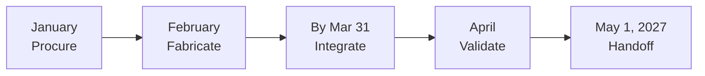

# Milestones & Timeline

The project runs through **11 milestones**, set on WBS Day (Nov 16, 2026), and **34 work packages**.

| # | Milestone | Window | Key work |
| --- | --- | --- | --- |
| M01 | Interim Presentation | Due Nov 30, 2026 | Team slides |
| M02 | Validating a Concept | Fall 2026 | Concept 5 chosen with the sponsor |
| M03 | Passing Design Review | CDR, date TBD | Critical design review |
| M04 | Order Initial Materials and Supplies | Nov 25 – Dec 11, 2026 | Sensors, dev board, inclinometer |
| M05 | First Design Concept | Jan 11 – Feb 5, 2027 | Firmware (WP 5.4), schematic, PCB layout |
| M06 | Make a First Prototype | Feb 8 – Mar 5, 2027 | Assembly (6.1), component tests (6.2) |
| M07 | Comprehensive Prototype | Mar 8 – Apr 2, 2027 | Integration (7.3), bench accuracy at ±1° (7.4), RS-485 test (7.5) |
| M08 | On-Site Calibration | Apr 5 – 14, 2027 | Field calibration at the ARRAY site (8.3, 8.4) |
| M09 | Finalized Bill of Materials | Apr 5 – 30, 2027 | Production BOM |
| M10 | Final Report | Apr 5 – 30, 2027 | Final documentation |
| M11 | Innovation Showcase | Apr 5 – 30, 2027 | Public demo |

## Timeline so far

| Date | Event |
| --- | --- |
| Sep 28, 2026 | Project Charter & Briefing submitted |
| Oct 3, 2026 | Requirements & Success Criteria mini-paper submitted |
| Oct 22, 2026 | Benchmarking report submitted |
| Oct 28, 2026 | Preliminary Design Review |
| Nov 3, 2026 | Sponsor meeting: Concept 5 selected |
| Nov 5, 2026 | Concept Development mini-paper submitted |
| Nov 9, 2026 | Map Day (team mapping session) |
| Nov 16, 2026 | WBS Day: 11-milestone plan set |
| Nov 19, 2026 | Sensor range finding leads to the TFmini range-test plan |
| Nov 20, 2026 | Project Execution Plan submitted |
| Nov 23, 2026 | Budget finalized at $540 |
