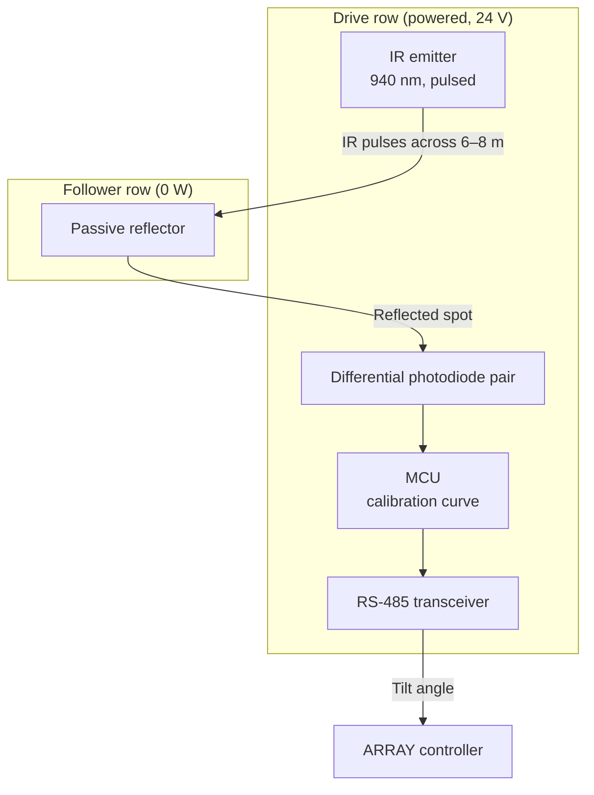

# Our Solution: Concept 5

An **infrared emitter and detector on the drive row**, and a **passive reflector on the follower row**. The follower row needs no electronics and no power.

## How it works

1. **Emit.** The drive-row unit fires modulated 940 nm infrared pulses across the 6–8 m gap to the follower row.
2. **Reflect.** A passive reflector mounted on the follower row sends the light back. It needs no power or electronics.
3. **Detect.** A differential pair of photodiodes on the drive row reads where the returned spot lands. As the follower row tilts, the spot moves, and the ratio between the two detectors changes.
4. **Convert.** The MCU maps that ratio to a tilt angle using a calibration curve built against a reference inclinometer.
5. **Report.** The drive-row unit sends the tilt angle to the ARRAY controller over RS-485.

!!! quote "The reflected light is the follower row's only output"
    Its tilt is encoded in where the light comes back.

## Why this approach

- **It meets the zero-power constraint directly.** All powered parts sit on the drive row.
- **There's no wiring between rows.** Cable between rows was the main cost of the magnetic-encoder concept.
- **Parts are cheap at volume.** The emitter and both detectors cost under $2 together at about 100 units.

## Reflector variants

The sponsor approved prototyping two reflector shapes, and we'll compare them on the bench:

- a **flat square** reflector
- a **shaped** reflector

## Biggest risk: range

The bare emitter and detector pair is a 3–4 m class link, but rows sit 6–8 m apart. Getting a usable return signal across that distance in full sunlight is the #1 design risk. See the [Nov 19 decision](decisions.md#nov-19-2026-sensor-range-revision) for how we're testing it.
